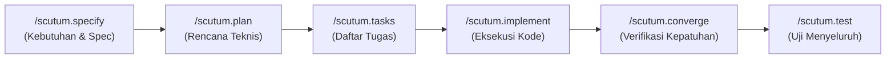
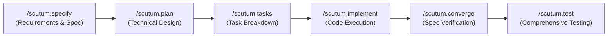

<div align="center">

# 🛡️ Scutum

**Spec-Driven Development (SDD) & AI Agent Governance Framework**

[](LICENSE)
[]()
[]()

<br />

[🇮🇩 **Bahasa Indonesia**](#-bahasa-indonesia) &nbsp;•&nbsp; [🇬🇧 **English Version**](#-english-version)

---

</div>

<a id="indonesian"></a>
## 🇮🇩 Bahasa Indonesia

Scutum adalah framework tata kelola rekayasa perangkat lunak otonom berbasis **Spec-Driven Development (SDD)**. Framework ini dirancang khusus untuk memandu dan menjaga asisten koding AI (seperti **Antigravity IDE** dan **Claude Code**) agar selalu bekerja terstruktur, aman, patuh terhadap standar konstitusi arsitektur, dan minim risiko regresi (*zero-error tolerance*).

---

### 🌟 Fitur Utama

- **Spec-Driven Development (SDD)**: Siklus pengembangan terstruktur: *Specify* $\rightarrow$ *Plan* $\rightarrow$ *Tasks* $\rightarrow$ *Implement* $\rightarrow$ *Converge* $\rightarrow$ *Test*.
- **Konstitusi & Tata Kelola Proyek**: Mengunci prinsip arsitektur, konvensi kode, dan standar keamanan yang wajib ditaati AI sebelum menulis kode.
- **Dukungan Multi-Platform AI**: Terintegrasi penuh dengan **Antigravity IDE** (melalui Workspace Skills & `AGENTS.md`) dan **Claude Code** (melalui `.claude/commands/`).
- **Alat Lengkap Seluruh Siklus SDLC**: Mencakup 23 alur kerja mulai dari reverse engineering (*brownfield*), perombakan UI (*redesign/revamp*), upgrade dependensi, hingga observabilitas dan investigasi insiden (*operate & postmortem*).

---

### 🧭 Alur Kerja Utama (Core SDD Cycle)



---

### 📋 Katalog Perintah Scutum

Gunakan perintah di bawah ini langsung di kolom chat AI:

| Perintah | Kategori | Deskripsi |
| :--- | :--- | :--- |
| `/scutum` | **Concierge** | Router utama dan panduan interaktif alur kerja. |
| `/scutum.constitution` | **Governance** | Menetapkan atau mengamandemen prinsip dasar dan aturan arsitektur proyek. |
| `/scutum.specify` | **SDD Core** | Menyusun spesifikasi fitur, *user stories*, dan kriteria penerimaan (`spec.md`). |
| `/scutum.plan` | **SDD Core** | Merancang rencana teknis, dependensi, dan arsitektur (`plan.md`). |
| `/scutum.tasks` | **SDD Core** | Menguraikan rencana teknis menjadi tugas-tugas terurut dependensinya (`tasks.md`). |
| `/scutum.implement` | **SDD Core** | Mengimplementasikan kode per fase sesuai daftar tugas secara ketat. |
| `/scutum.converge` | **SDD Core** | Memverifikasi apakah hasil koding sudah memenuhi spec dan rencana awal. |
| `/scutum.test` | **Quality** | Menjalankan uji *unit*, *integration*, serta verifikasi cakupan kode. |
| `/scutum.clarify` | **Refinement** | Mengklarifikasi ambiguitas dan pertanyaan terbuka pada kebutuhan fitur. |
| `/scutum.checklist` | **Quality** | Membuat daftar periksa review kualitas sebelum *merge/pull request*. |
| `/scutum.analyze` | **Quality** | Audit struktural, konsistensi kode, dan kepatuhan arsitektur proyek. |
| `/scutum.redesign` | **Maintenance** | Merombak satu komponen, endpoint, atau layar yang terisolasi. |
| `/scutum.revamp` | **Maintenance** | Perombakan besar multi-modul lintas aplikasi secara bertahap. |
| `/scutum.upgrade` | **Maintenance** | Upgrade versi framework atau dependensi secara aman dan bertahap. |
| `/scutum.tracer` | **Debugging** | Pelacakan akar masalah (*root-cause analysis*) dari gejala bug yang dilaporkan. |
| `/scutum.prototype` | **Fast-Track** | Membuat prototipe cepat (*throwaway PoC*) untuk validasi awal. |
| `/scutum.deploy` | **Operations** | Otomasi kontainerisasi dan penyiapan pipeline CI/CD. |
| `/scutum.operate` | **Operations** | Konfigurasi telemetri, observabilitas, dan penanganan insiden produksi. |
| `/scutum.postmortem` | **Operations** | Merangkum pembelajaran insiden ke pembaruan spec & konstitusi. |
| `/scutum.brd` | **Brownfield** | Reverse-engineering kode legacy menjadi Dokumen Kebutuhan Bisnis (BRD). |

---

### 🚀 Cara Penggunaan

#### 1. Pada Antigravity IDE
- **Menu Dropdown Autocomplete**: Ketik `/scutum.` pada input chat untuk melihat daftar seluruh sub-command Scutum secara otomatis.
- **Concierge Interaktif**: Jika bingung harus mulai dari mana, ketik `/scutum` lalu tekan Enter. Scutum akan menampilkan panduan tahap berikutnya.
- **Bahasa Alami**: Anda juga dapat memberikan instruksi seperti *"Gunakan scutum.specify untuk membuat fitur login"*.

#### 2. Pada Claude Code
- Ketik perintah slash resmi, misalnya:
  ```bash
  /scutum.specify Buat fitur otentikasi JWT
  /scutum.plan
  /scutum.implement
  ```

---

### 📂 Struktur Repositori

```text
scutum/
├── .agents/                      # Konfigurasi Antigravity IDE
│   ├── commands/                 # Definisi spesifikasi 23 command Scutum
│   └── skills/                   # Workspace Skills (Autocomplete /scutum.*)
├── .claude/                      # Konfigurasi Claude Code
│   ├── commands/                 # Slash commands untuk Claude Code CLI
│   └── settings.json             # Pengaturan izin keamanan dan hooks
├── .scutum/                      # Mesin Tata Kelola & Penyimpanan
│   ├── hooks/                    # Guard script (Python)
│   ├── memory/                   # Konstitusi proyek (constitution.md)
│   ├── scripts/powershell/       # Skrip otomatisasi alur kerja
│   └── templates/                # Template spec, plan, tasks, dan standar keamanan
├── AGENTS.md                     # Aturan context untuk Antigravity IDE
└── CLAUDE.md                     # Aturan context untuk Claude Code
```

<div align="right">
<a href="#scutum">⬆️ Kembali ke atas</a> &nbsp;|&nbsp; <a href="#english">🇬🇧 Read in English</a>
</div>

---

<a id="english"></a>
## 🇬🇧 English Version

Scutum is an autonomous software engineering governance framework powered by **Spec-Driven Development (SDD)**. It is purpose-built to guide and govern AI coding assistants (such as **Antigravity IDE** and **Claude Code**) to ensure they operate in a structured, secure, architecturally compliant, and regression-free manner (*zero-error tolerance*).

---

### 🌟 Key Features

- **Spec-Driven Development (SDD)**: Rigorous lifecycle: *Specify* $\rightarrow$ *Plan* $\rightarrow$ *Tasks* $\rightarrow$ *Implement* $\rightarrow$ *Converge* $\rightarrow$ *Test*.
- **Constitution & Governance**: Enforces architectural invariants, coding conventions, and security standards before any code is generated.
- **Multi-Platform AI Support**: Fully integrated with **Antigravity IDE** (via Workspace Skills & `AGENTS.md`) and **Claude Code** (via `.claude/commands/`).
- **Full SDLC Toolkit**: Features 23 workflows covering brownfield reverse engineering (`/scutum.brd`), component redesigns, dependency upgrades, to operational telemetry and incident post-mortems.

---

### 🧭 Core SDD Workflow



---

### 📋 Scutum Command Catalog

Invoke any of the following commands directly in your AI chat:

| Command | Category | Description |
| :--- | :--- | :--- |
| `/scutum` | **Concierge** | Front door and interactive workflow router. |
| `/scutum.constitution` | **Governance** | Establish or amend project principles and architectural invariants. |
| `/scutum.specify` | **SDD Core** | Draft feature requirements, user stories, and acceptance criteria (`spec.md`). |
| `/scutum.plan` | **SDD Core** | Design technical architecture, dependencies, and implementation strategy (`plan.md`). |
| `/scutum.tasks` | **SDD Core** | Break down technical plans into ordered, actionable steps (`tasks.md`). |
| `/scutum.implement` | **SDD Core** | Implement code phase by phase according to tasks with zero unauthorized drift. |
| `/scutum.converge` | **SDD Core** | Verify that implemented code fulfills the original specifications and plan. |
| `/scutum.test` | **Quality** | Run comprehensive unit, integration, and contract test suites. |
| `/scutum.clarify` | **Refinement** | Resolve ambiguities and open questions in feature requirements. |
| `/scutum.checklist` | **Quality** | Generate quality, security, and PR review checklists. |
| `/scutum.analyze` | **Quality** | Inspect codebase structure, consistency, and constitutional health. |
| `/scutum.redesign` | **Maintenance** | Refactor or redesign an isolated screen, endpoint, or component. |
| `/scutum.revamp` | **Maintenance** | Coordinate large-scale, multi-module overhauls in phased batches. |
| `/scutum.upgrade` | **Maintenance** | Safely upgrade framework or dependency versions with breaking-change mitigation. |
| `/scutum.tracer` | **Debugging** | Trace bug symptoms to their root cause in logic or data models. |
| `/scutum.prototype` | **Fast-Track** | Build quick, throwaway proof-of-concept implementations for early validation. |
| `/scutum.deploy` | **Operations** | Automate containerization and CI/CD pipeline configuration. |
| `/scutum.operate` | **Operations** | Wire telemetry, observability, and investigate live production anomalies. |
| `/scutum.postmortem` | **Operations** | Translate incident lessons into updated specs and constitution rules. |
| `/scutum.brd` | **Brownfield** | Reverse-engineer legacy codebases into Business Requirements Documents (BRD). |

---

### 🚀 Getting Started

#### 1. In Antigravity IDE
- **Slash Autocomplete**: Type `/scutum.` into the chat input to see all available sub-commands in the dropdown menu.
- **Interactive Concierge**: If you are unsure where to start, type `/scutum` and hit Enter. Scutum will present an interactive guide.
- **Natural Language**: You can also prompt in natural language, e.g., *"Run scutum.specify for the user authentication feature"*.

#### 2. In Claude Code
- Use the standard slash command syntax:
  ```bash
  /scutum.specify Implement OAuth2 login
  /scutum.plan
  /scutum.implement
  ```

---

### 📂 Repository Structure

```text
scutum/
├── .agents/                      # Antigravity IDE configuration
│   ├── commands/                 # 23 Scutum command specifications
│   └── skills/                   # Workspace Skills (Autocomplete /scutum.*)
├── .claude/                      # Claude Code configuration
│   ├── commands/                 # Slash commands for Claude Code CLI
│   └── settings.json             # Security permissions and hook triggers
├── .scutum/                      # Governance Engine & Memory
│   ├── hooks/                    # Guard script (Python)
│   ├── memory/                   # Project constitution (constitution.md)
│   ├── scripts/powershell/       # Automation scripts
│   └── templates/                # Spec, plan, tasks, and security standard templates
├── AGENTS.md                     # Context and rules for Antigravity IDE
└── CLAUDE.md                     # Context and rules for Claude Code
```

<div align="right">
<a href="#scutum">⬆️ Back to Top</a> &nbsp;|&nbsp; <a href="#indonesian">🇮🇩 Baca versi Bahasa Indonesia</a>
</div>
